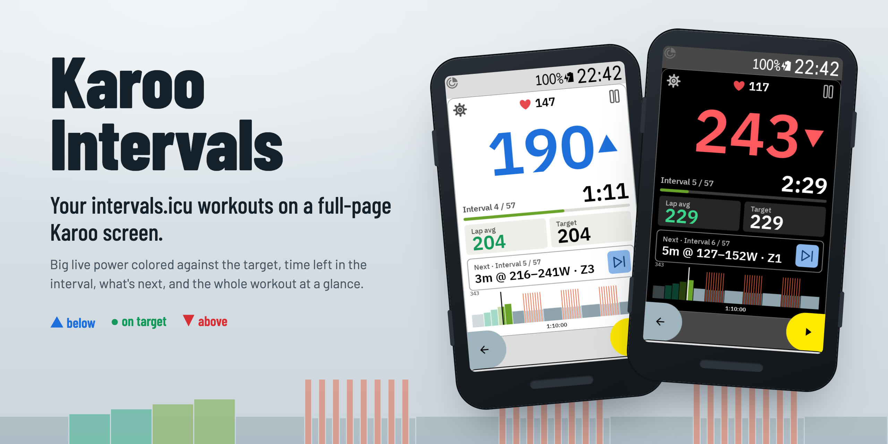
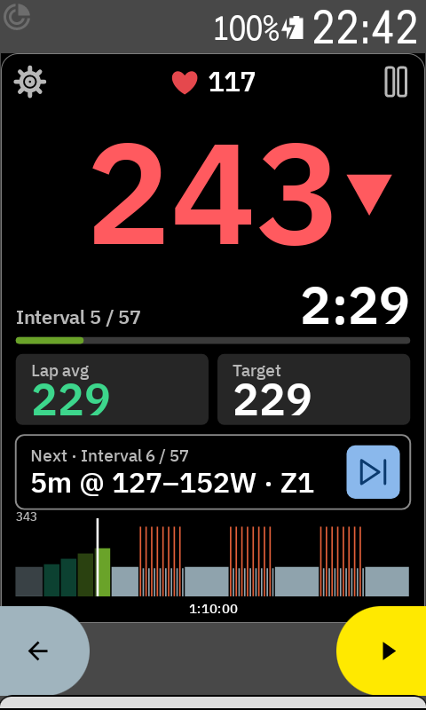
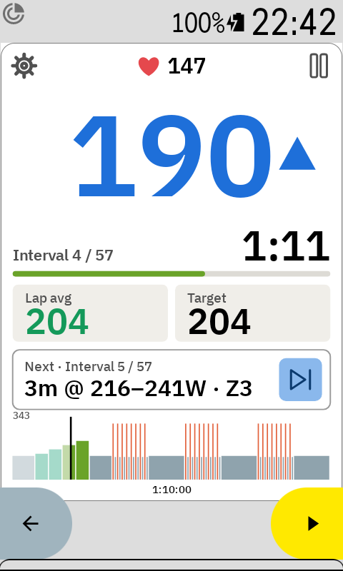
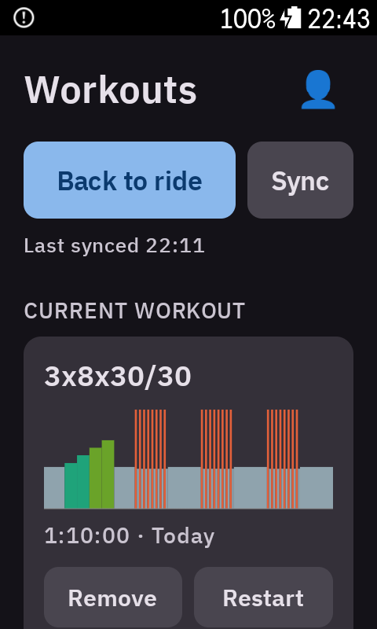
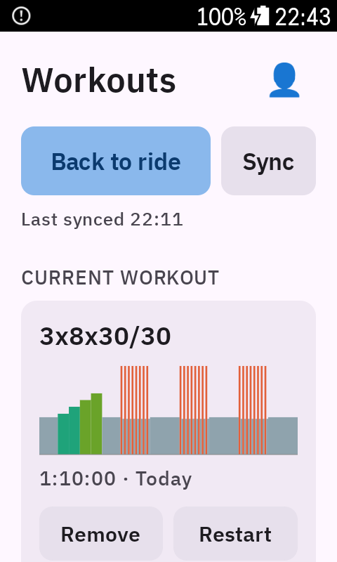

<p align="center">
  
</p>

<p align="center">
  
  
  <a href="LICENSE"></a>
</p>

# Karoo Intervals

A Hammerhead Karoo extension that runs your **planned intervals.icu workouts** on a
**full-page workout screen** made for glancing at mid-interval:

- **Big live power** (3 s), colored against the interval target: blue ▲ below, green in range, red ▼ above.
- **Time left in the interval**, a progress bar, and **Interval x / n**.
- **Lap avg** and **Target** side by side. The lap average is colored too, so you see whether the whole interval is on target.
- **What's next** (`3m @ 216–241W · Z3`) with a **skip** button.
- **The whole workout profile** with a marker for where you are.
- Beeps 3-2-1 before every interval change, an in-ride alert with the new target, and an automatic lap per interval.

Works in Karoo's **dark and light** mode.

<table>
  <tr>
    <td align="center"></td>
    <td align="center"></td>
    <td align="center"></td>
    <td align="center"></td>
  </tr>
  <tr>
    <td align="center"><sub>Above target ▼</sub></td>
    <td align="center"><sub>Below target ▲</sub></td>
    <td align="center"><sub>Workout picker</sub></td>
    <td align="center"><sub>…in light mode</sub></td>
  </tr>
</table>

---

## Install

Requires a **Karoo 3**, a paired **power meter**, and an [intervals.icu](https://intervals.icu)
account with workouts on your calendar. Karoo 2 may work but is untested.

1. Build the APK (see [Building from source](#building-from-source)) or download it from a release.
2. [Enable USB debugging](#enable-usb-debugging) on the Karoo and connect it.
3. Install:

   ```sh
   adb install -r karoo_intervals_screen-<version>-release.apk
   ```

---

## Setup

1. **Add your intervals.icu API key.** Open **Intervals Screen** from the app drawer (or tap it in
   **Settings → Extensions**), tap 👤, paste your key and tap **Save key**. You find the key in
   intervals.icu under **Settings → Developer Settings**.
2. **Sync.** Tap **Sync**. The app loads your FTP and power zones plus every planned ride workout
   from yesterday to seven days ahead. It also refreshes in the background when the cache is
   older than an hour.
3. **Pick a workout.** Tap it under **This week**. It moves to **Current workout**.
4. **Add the screen.** In a ride profile, add a **new data page** and put **only the
   Workout Screen field** on it, at full size. An indoor profile is best: outdoors, Karoo's
   "Acquiring GPS" banner covers the top row until GPS is found.

---

## Riding

The workout starts with the first second of recorded ride time and follows Karoo's ride clock,
so **auto-pause and manual pause also pause the workout**.

| Tap | Does |
|-----|------|
| ⚙ (top left)  | Opens the workout picker. **Back to ride** returns. |
| ‖ (top right) | Pauses **only the workout**: the interval timer stops, the recording keeps running. Tap again to resume. Use Karoo's own pause button to pause the ride. |
| ⏭ (next card) | Skips to the next interval. |

**Target colors.** A range like 140–165 W uses its own bounds. A single value like 181 W gets ±5 %.
For ramps the live power is judged against the current ramp target ±5 %, and the lap average
against the average target so far. There's no verdict in the first 5 seconds of an interval, on
free-ride or heart-rate steps, or without power data.

The workout restarts from the first interval on the next ride. **Restart** in the picker starts
it over mid-ride.

### Limits

- **No ERG / trainer control.** The Karoo extension SDK can't steer a trainer; targets are shown,
  not set.
- Only **planned** workouts (calendar, yesterday … +7 days). The Karoo's network proxy caps
  responses at 100 KB, too small for the whole workout library.
- Distance-based steps are skipped; power (`%FTP`, watts, power zones) and `%LTHR` targets are supported.
- Karoo's ride controls at the bottom of the screen belong to Karoo and can't be used by the field.

---

## Building from source

### Requirements

- **JDK 17**, the Android SDK, and `adb` on your `PATH`.
- A **GitHub personal access token** with the `read:packages` scope. The Karoo SDK
  ([`hammerheadnav/karoo-ext`](https://github.com/hammerheadnav/karoo-ext)) is published to
  GitHub Packages. Add it to `~/.gradle/gradle.properties`:

  ```properties
  gpr.user=your-github-username
  gpr.key=ghp_xxxxxxxxxxxxxxxxxxxx
  ```

Release builds are signed with the local Android debug keystore, so they install directly.

### Build and install

```sh
export JAVA_HOME=$(/usr/libexec/java_home -v 17)
./gradlew :app:testDebugUnitTest
./gradlew :app:assembleRelease
adb install -r app/build/outputs/apk/release/karoo_intervals_screen-0.1.0-release.apk
```

### Enable USB debugging

1. On the Karoo, open **Settings → About** and tap **Build number** seven times.
2. Open **Settings → System → Developer Options** and turn on **USB debugging**.
3. Connect over USB and accept the prompt on the device. `adb devices` should list it as
   `device` (not `unauthorized`).

### Debug builds and the simulator

Debug builds read `INTERVALS_ICU_API_KEY=...` from a git-ignored `.env` file in the repo root, so
you don't have to type the key on the Karoo. Release builds never contain a key.

Debug builds also have a **Simulator** switch under 👤: synthetic power and heart rate at 5× speed,
with power following the target. It stays silent (no beeps, no laps) and shows a red **SIM**
marker. Turn it off before a real ride.

---

## License

[MIT](LICENSE)
